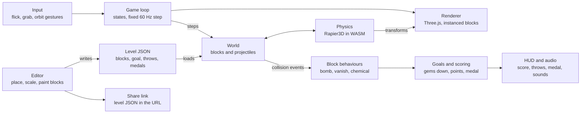
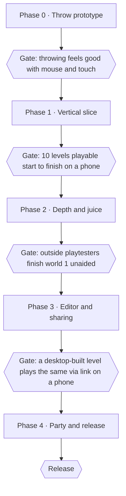

# Boom Blox Web Clone — Research, Game Plan & Implementation Plan

As of 2026-10-22 · Jan Thure · Online version: https://claude.ai/artifact/K3nbh5k6DTAqbxoYiymC3J

## Summary

Build a browser game that recreates Boom Blox's core loop — throw, grab and blast physics blocks to solve short puzzles — in TypeScript with Three.js and Rapier3D, shipped as a static site. Ship a playable vertical slice (throw + 6 block types + 10 levels) first, then grab mode, a level editor and shareable levels.
- **Engine:** Three.js for rendering, Rapier3D (WASM) for physics, Vite for builds. No Unity: WebGL exports are heavy and slow to iterate; Unity/C# repos are used as design references only.
- **Input:** mouse/touch "flick to throw" replaces the Wii Remote swing; throw speed comes from pointer velocity, snapped to 4 power tiers like the original.
- **Scope:** mechanics and level ideas are cloned; name, characters, art, music and levels are original (see Risks).
- **Levels:** JSON files, so the editor, sharing and hand-authored levels all use one format.

## The original game

Boom Blox (EA Los Angeles with Steven Spielberg, Wii, May 2008) is a physics puzzle game about knocking down or carefully dismantling block structures. Reviewers summed it up as Jenga meets Tetris Blast, Breakout, Duck Hunt and Lego ([Wikipedia](https://en.wikipedia.org/wiki/Boom_Blox)). A sequel, Boom Blox Bash Party, followed in 2009.

**Core verbs** ([Nintendo wiki](https://nintendo.fandom.com/wiki/Boom_Blox), [Wikipedia](https://en.wikipedia.org/wiki/Boom_Blox))
- **Throw** — aim a cursor, swing to launch a ball, bowling ball, bomb ball etc. Result depends on launch angle, throw speed and projectile mass; the game recognised four distinct throw speeds.
- **Grab** — Jenga mode: grab a block and pull it out of the tower without toppling it.
- **Shoot / spray** — laser guns at targets, fire hose to push structures (the developers' least favourite mode; the sequel de-emphasised it).

**Block types** — 14 in total ([Giant Bomb](https://giantbomb.com/wiki/Games/Boom_Blox), [bit-tech](https://www.bit-tech.net/reviews/gaming/nintendo/boom-blox/2/))

| Block            | Look           | Behaviour                                         |
| ---------------- | -------------- | ------------------------------------------------- |
| Normal           | plain          | standard movable block                            |
| Wood             | wood grain     | light                                             |
| Steel            | metal          | heavy, hard to shift                              |
| Immobile         | dark grey      | cannot move or break                              |
| Gem              | sparkling blue | goal: usually must fall                           |
| Point            | gold           | scores points when knocked off                    |
| Penalty          | —              | loses points if it touches the floor              |
| Bomb             | red            | explodes on any hit, flinging neighbours          |
| Chemical         | green          | explodes only when two chemical blocks touch      |
| Vanish           | purple         | disappears when hit                               |
| Multi-hit vanish | purple         | needs several hits                                |
| Fragile          | —              | shatters on a full-force hit only                 |
| Cloud            | —              | lighter than air, floats up                       |
| Ice              | —              | low friction, slides                              |
| Jingle           | coloured       | plays a note on hit (music levels)                |
| Fireworks        | —              | launches up and explodes when hit or near a blast |

The original also had 22 "toys" (projectiles and tools), score-multiplier zones that point blocks can be knocked into, and bronze/silver/gold medals per level ([TV Tropes](https://www.tvtropes.org/pmwiki/pmwiki.php/VideoGame/BoomBlox)).

**Modes and content** ([Giant Bomb](https://giantbomb.com/wiki/Games/Boom_Blox), [MobyGames](https://www.mobygames.com/game/34414/))
- **Explore** — tutorial sets per mechanic: Gem, Point, Bomb, Vanish, Chemical, Grab.
- **Adventure** — four stories (medieval gems, Wild West gold, jungle rescue, Halloween), each 3 acts; over 300 single-player levels total, with limited throws and time limits.
- **Party** — 100+ competitive and co-op levels for 1–4 players.
- **Create** — level editor: place, scale and paint blocks; share with friends.

**Look and feel** — bright, cute and deliberately blocky; block-shaped animal characters; soundtrack by Mark Mothersbaugh.

## Reference media

Links for study, not assets to reuse — screenshots and footage stay EA's. Watch for camera framing, block scale versus projectile, how collapses read, and the score/medal UI.

| Source                                                                                                                     | Type                             | Useful for                                             |
| -------------------------------------------------------------------------------------------------------------------------- | -------------------------------- | ------------------------------------------------------ |
| [Is Boom Blox a Wii Hidden Gem? (YouTube)](https://www.youtube.com/watch?v=hl6JFya6vvY)                                    | video review, long-form gameplay | pacing, level variety, feel of throws                  |
| [Worthplaying announcement](https://worthplaying.com/article/2008/2/6/news/48582-boom-blox-wii-announced-screens-trailer/) | screens + debut trailer          | themes (Tiki, Medieval, Frontier, Haunted), characters |
| [Engadget announcement](https://www.engadget.com/2008-02-06-ea-spileberg-break-out-boom-blox-for-wii.html)                 | gallery + trailer                | editor promise, 30+ characters                         |
| [TrustedReviews review](https://www.trustedreviews.com/reviews/boom-blox)                                                  | ~14 screenshots                  | art style, explosion and score pop-ups                 |
| [Giant Bomb wiki](https://giantbomb.com/wiki/Games/Boom_Blox)                                                              | description                      | full block list, modes, editor                         |
| [bit-tech review](https://www.bit-tech.net/reviews/gaming/nintendo/boom-blox/2/)                                           | review + screens                 | block colour coding, level goals                       |
| [GameFAQs walkthrough](https://www.gamerevolution.com/?p=41199)                                                            | FAQ text                         | level-by-level solutions, grab-mode tips               |
| [MobyGames](https://www.mobygames.com/game/34414/)                                                                         | catalogue + screens              | modes, mobile version (40 puzzles)                     |
| [BoomBloxDemo preview (YouTube)](https://youtu.be/703Htv5oOoE)                                                             | fan Unity demo video             | what a minimal clone looks like                        |

For more footage, search YouTube for "Boom Blox longplay" (full Adventure runs) and "Boom Blox create mode" (editor UI).

## Code references

No full open-source Boom Blox clone exists; the closest are small demos. The best web starting point is RepoBlocks (Three.js + Rapier, GPL-3.0); the Unity repos are useful for structure ideas, not code to port.

| Repo                                                                                                        | Stack                                | License        | What it has                                                                                                                                              | What to take                                                   |
| ----------------------------------------------------------------------------------------------------------- | ------------------------------------ | -------------- | -------------------------------------------------------------------------------------------------------------------------------------------------------- | -------------------------------------------------------------- |
| [Storm-Develop/BoomBloxDemo](https://github.com/Storm-Develop/BoomBloxDemo)                                 | Unity, C#                            | MIT            | 1 level, shoot bullets at blocks, win when all removed, R to restart; [write-up](https://medium.com/@vladsamonin/boom-blox-game-in-unity3d-4417f336d3ea) | event/observer setup for score and game state; block-type enum |
| [nikitbobba/Angry-Birds-Predecessor](https://github.com/nikitbobba/Angry-Birds-Predecessor)                 | Unity, C# (2D)                       | none stated    | 2D game based on Boom Blox                                                                                                                               | level/goal ideas only                                          |
| [kigbariom/MLJ](https://github.com/kigbariom/MLJ)                                                           | Unity, C#                            | none stated    | 3D Jenga with physics                                                                                                                                    | grab-and-pull handling                                         |
| [PranavBahuguna/MyJenga](https://www.github.com/PranavBahuguna/MyJenga)                                     | Unity, C#                            | none stated    | Jenga tower collapse, stone/wood/glass blocks                                                                                                            | per-material block physics                                     |
| [provencher/repoblocks](https://github.com/provencher/repoblocks)                                           | TS, Three.js, Rapier3D, bitECS, Vite | GPL-3.0        | click to shoot balls at a tower, reset level, 60 Hz fixed step, CCD, tests                                                                               | closest web base: physics/render split, entity factories       |
| [newhook/gameboiler](https://github.com/newhook/gameboiler)                                                 | TS, Three.js, Rapier, Vite           | not checked    | cubes with explosion particles, game states, sound manager                                                                                               | explosion effects, state manager                               |
| [vitalspace/three.js-with-physics-Rapier.js](https://github.com/vitalspace/three.js-with-physics-Rapier.js) | JS, Three.js, Rapier                 | stated in repo | minimal Rapier ↔ Three sync                                                                                                                              | sync loop reference                                            |

License note: RepoBlocks is GPL-3.0, so copying its code makes the clone GPL too. Either accept that (fine for a hobby project) or use it as reference and write our own. Repos with no license cannot be copied at all.

## Game design draft

Working title: **Blox Topple** (placeholder — pick an original name before publishing). One level = one structure, one goal, a limited number of throws, a medal at the end; a level should take 20–90 seconds.

**Core loop**
1. Look: orbit the camera around the structure (drag with right button / two fingers).
2. Aim: cursor over a block shows a target ring and a faint trajectory arc.
3. Act: flick to throw, or hold to grab and pull (grab levels).
4. Watch: physics settles; score pops float up; slow-mo on big chain reactions.
5. Result: when the goal is met, throws run out, or the scene is still for 2 s → medal screen, retry or next.

**Controls**
- **Desktop:** left-press on target, drag back and release forward; release speed sets power (4 tiers: tap, light, medium, full). Space = quick full-power throw for accessibility.
- **Touch:** same flick gesture; two-finger drag orbits, pinch zooms.
- **Grab:** press and hold a block, drag to pull; the block follows on a soft spring, so yanking too hard wobbles the tower.
- **Later:** gamepad and motion controls on phones (DeviceMotion swing).

**Tools (projectiles)** — MVP: ball, heavy ball, bomb ball. Later: soft/bouncy ball, laser (instant hit, small impulse), water hose (continuous push), grab hand.

**Block set** — MVP (6): normal, immobile, gem, point, bomb, vanish. Phase 2: wood, steel, chemical, penalty, ice, multi-hit vanish. Phase 3: fragile, cloud, fireworks, jingle. Each type is data: mass, friction, restitution, colour/texture, and an optional behaviour (explode, vanish, float, chain).

**Level goal types**
- Topple all gems (knock every gem block to the floor).
- Score target with point blocks; penalty blocks subtract.
- Clear the board (all non-immobile blocks off the platform).
- Jenga: remove N blocks without the tower falling (grab mode).
- Multiplier zones: knock point blocks into ×2 / ×3 floor areas.

**Scoring and medals** — points from point blocks, chains and unused throws; bronze / silver / gold thresholds per level, stored locally.

**Modes**
- **Explore** — 6 short tutorial sets, one per mechanic (gem, point, bomb, vanish, chemical, grab).
- **Adventure** — 4 original themed worlds of ~12 levels each, light story told with characters on the platform.
- **Party** — hot-seat 2–4 players: alternate throws, points per turn; Jenga-off (last to topple wins).
- **Create** — level editor; share by link.

**Art and audio** — flat-shaded, chunky, saturated blocks with simple face decals; soft shadows, small toy-like scale; cartoony thuds, wood clacks, cartoon booms; original upbeat music.

## Technical architecture

A static TypeScript site: a fixed-step game loop advances Rapier physics, copies body transforms to Three.js, and routes collision events to per-block behaviours that drive scoring. No backend is needed until a hosted level gallery.



The loop owns time; everything else reacts. Levels, the editor and share links all speak the same JSON format.

| Layer            | Choice                                                          | Why                                                              |
| ---------------- | --------------------------------------------------------------- | ---------------------------------------------------------------- |
| Language / build | TypeScript, Vite                                                | fast reload, typed level schema                                  |
| Rendering        | Three.js, InstancedMesh per block type                          | one draw call per block type, good on phones                     |
| Physics          | @dimforge/rapier3d-compat                                       | fast, stable stacking, CCD for fast balls, collision event queue |
| Game state       | plain TS classes + small event bus                              | simpler than a full ECS at this size                             |
| UI / HUD         | HTML overlay (Preact or plain DOM)                              | menus and editor panels are easier in DOM than in WebGL          |
| Audio            | Web Audio (Howler.js)                                           | pooled one-shots, pitch variation per impact                     |
| Storage          | localStorage for progress; lz-string level in URL hash          | sharing without a server                                         |
| Tests            | Vitest (goal and scoring rules headless), Playwright smoke test | catch physics/goal regressions                                   |
| Hosting          | GitHub Pages, Netlify or Cloudflare Pages                       | free static hosting                                              |

**Level format (sketch)**

```json
{
  "id": "gem-01",
  "theme": "meadow",
  "tool": "ball",
  "throws": 3,
  "goal": { "type": "toppleGems" },
  "medals": { "bronze": 100, "silver": 250, "gold": 400 },
  "blocks": [
    { "type": "normal", "pos": [0, 0.5, 0], "size": [1, 1, 1], "rot": 0 },
    { "type": "gem", "pos": [0, 1.5, 0] },
    { "type": "bomb", "pos": [1, 0.5, 0] }
  ],
  "zones": [{ "multiplier": 2, "pos": [3, 0, 0], "size": [2, 2] }]
}
```

**Key implementation details**
- Throw: on release, take pointer velocity over the last ~80 ms, snap to 4 power tiers, launch along the camera ray to the target with a small upward bias.
- Grab: raycast to pick, make a kinematic anchor at the cursor and join it to the block with a spring; limit pull force so yanks wobble the stack.
- Bomb / chemical: on qualifying contact, queue an explosion; next step apply radial impulses with falloff to bodies in radius and wake them; chain bombs with a 100–200 ms delay for readability.
- Goals: evaluate after the scene sleeps (all bodies asleep or 2 s with no motion) — avoids early wins mid-collapse.
- Stability: blocks spawn asleep, solver iterations 8+, restitution near 0.1, friction per block type.

## Implementation plan

Five phases, each ending in something playable; nothing moves past Phase 0 until the throw feels right, because every level depends on it. Rough effort for one person on evenings and weekends: 1–2 weeks for Phase 0, 3–4 for Phase 1, then 4–6 per later phase (a guess — AI coding agents can shorten the plumbing, not the feel-tuning).



**Phase 0 — Throw prototype**
- [x] Scaffold Vite + TypeScript; add three and @dimforge/rapier3d-compat
- [x] Fixed 60 Hz physics step with render interpolation; body ↔ mesh sync
- [x] Ground, lights, one shadow, orbit camera (drag / pinch)
- [x] Spawn a tower of 20 blocks asleep; tune solver iterations until it stands still
- [x] Flick gesture → velocity → 4 power tiers → ball launched toward the target ray
- [x] Debug panel (lil-gui): gravity, ball mass, power curve, friction, restitution
- [ ] Deploy to static hosting; test on a phone (throw tuned for mouse; phone test over LAN pending)

**Phase 1 — Vertical slice**
- [x] Level JSON schema + loader with validation (zod)
- [x] Block registry: normal, immobile, gem, point, bomb, vanish (data + behaviour hooks)
- [x] Collision event queue → behaviours; radial explosion impulse with chain delay
- [x] Settle detection and goal evaluation: topple gems, score target, clear board
- [x] Throws counter, medal screen, retry / next
- [x] Floating score pop-ups on fallen blocks
- [x] Level select with saved medals (localStorage)
- [x] 10 levels; Vitest tests for scoring and goal rules (24 levels now in `src/levels/`)

**Phase 2 — Depth and juice**
- [x] Grab tool: raycast pick + spring to kinematic cursor anchor; Jenga goal type
- [x] Blocks: wood, steel, chemical, penalty, ice, multi-hit vanish
- [x] Multiplier zones
- [x] Tools: heavy ball, bomb ball, bouncy ball
- [ ] Explore tutorial sets (6) and 2 themed Adventure worlds (~24 levels) — 24 standalone levels exist, not yet grouped into sets/worlds
- [x] Impact sounds by material and speed (synthesised), particles, camera shake
- [x] Slow-mo on chain reactions
- [x] Music: original synthesised loop (`src/music.ts`), own on/off button
- [ ] Playtest round; tune difficulty and medal thresholds

**Phase 3 — Editor and sharing - LATER**
- [ ] Editor mode: grid snap, place / move / scale / rotate / delete, block palette, paint type
- [ ] Level settings panel: goal, tool, throws, medal thresholds; test-play toggle
- [ ] Export/import JSON; share link with lz-string in the URL hash
- [ ] Local "My levels" library

**Phase 4 — Party and release**
- [x] Hot-seat 2–4 players: turn order, per-player score, Jenga-off (`src/party.ts`; pick player count in the level menu)
- [x] Remaining blocks: cloud, fragile, fireworks, jingle
- [x] Laser and hose tools (levels 25–28; hose `throws` = seconds of water)
- [ ] Last 2 Adventure worlds
- [x] Performance: instancing, body caps (300 blocks per level), sleep-based physics pause, shadow re-render only while moving, low/medium/high quality
- [x] PWA (offline, installable), keyboard / one-button throw, colour-blind-safe block markings
- [ ] Final name, logo, original art and music; launch page

## Risks, IP and open questions

**Risks**

| Risk                          | Why it matters                                      | Mitigation                                                                                                |
| ----------------------------- | --------------------------------------------------- | --------------------------------------------------------------------------------------------------------- |
| Throw feel is off             | the whole game rests on the flick feeling right     | build the throw first; tune with a debug panel (power curve, gravity, mass) before any content            |
| Tall stacks jitter or explode | box stacks are the hardest case for physics engines | Rapier with more solver iterations, sleeping on, blocks start asleep, small restitution, fixed 60 Hz step |
| Performance on phones         | 200+ bodies + shadows                               | cap bodies per level, instanced meshes, one shadow light, pause physics when all bodies sleep             |
| Non-deterministic replays     | browser float differences                           | don't promise replays or online sync; hot-seat multiplayer only                                           |
| WASM load time                | Rapier is ~1–2 MB                                   | lazy-load physics behind the title screen                                                                 |

**IP** — game mechanics are generally not protected, but names, characters, art, music and level layouts are. Use an original title and art, don't ship EA screenshots or audio, and describe it as "inspired by" rather than using the Boom Blox name. Not legal advice.

**Open questions**
- [ ] Hobby/open-source project or something to publish? (decides license and how careful to be with naming)
- [ ] Is a GPL license acceptable, so RepoBlocks code can be reused?
- [ ] Desktop-first or phone-first? (changes control and performance priorities)
- [ ] Should level sharing be link-only (no backend) or a hosted gallery?
- [ ] Build it yourself, with AI coding agents, or a mix?

## Sources

- [Boom Blox — Wikipedia](https://en.wikipedia.org/wiki/Boom_Blox)
- [Boom Blox — Giant Bomb wiki](https://giantbomb.com/wiki/Games/Boom_Blox)
- [Boom Blox — Nintendo wiki](https://nintendo.fandom.com/wiki/Boom_Blox)
- [Boom Blox review — bit-tech](https://www.bit-tech.net/reviews/gaming/nintendo/boom-blox/2/)
- [Boom Blox — TV Tropes](https://www.tvtropes.org/pmwiki/pmwiki.php/VideoGame/BoomBlox)
- [Boom Blox — MobyGames](https://www.mobygames.com/game/34414/)
- [Storm-Develop/BoomBloxDemo](https://github.com/Storm-Develop/BoomBloxDemo)
- [provencher/repoblocks](https://github.com/provencher/repoblocks)
